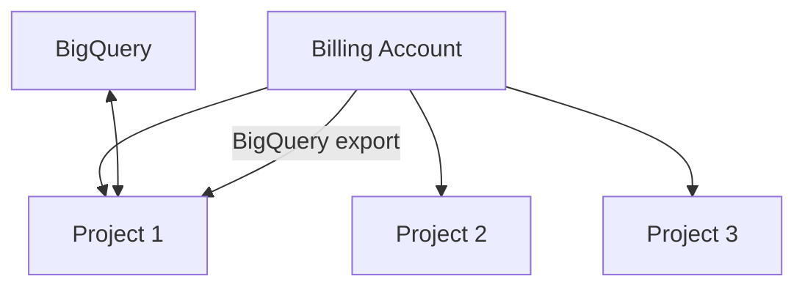

Connect your **GCP account** to Yasu by granting access to Yasu's service account with the necessary permissions. This connection enables Yasu to analyze your cloud costs and provide optimization recommendations.

For more detailed instructions on creating and managing Service Accounts and IAM roles in GCP, refer to the [official GCP IAM Documentation](https://cloud.google.com/iam/docs/roles-overview).

<iframe
  width="560"
  height="315"
  src="https://www.youtube.com/embed/Sdt-i-Q7tyA"
  title="YouTube video player"
  frameBorder="0"
  allow="accelerometer; autoplay; clipboard-write; encrypted-media; gyroscope; picture-in-picture"
  allowFullScreen
  style={{ width: '100%', borderRadius: '0.5rem', aspectRatio: '16/9' }}
></iframe>

## How the billing structure works in GCP

GCP can be confusing when it comes to billing. To make it a little more clear, you configure your billing export to send the billing data into a project. When you use multiple projects, all billing data will accumulate into one billing account (which exports again to a project → BigQuery).



## Steps to Connect

<Steps>
<Step title="Gather required information">

Before starting the connection process, make sure you have the following information ready:

**Required:**
- **Billing Account ID** - Required for accurate cost calculations
  - Format: `01ABCD-2EFGH3-456IJK`
  - Found in: GCP Console → Billing → Account Management
  - Example: `029B0D-80B502-B17C09`

- **BigQuery Dataset ID** - The full ID of the dataset that holds your Cloud Billing export
  - Format: `project-id.dataset_name` (for example `my-billing-project.billing_export`)
  - The part before the dot is the **project ID** (not the project number) of the project that hosts the billing export. Yasu reads the project from this value, so there is no separate Project ID field.

**Required for Organization scope only:**
- **Organization ID** - Numeric ID of your GCP organization
  - Format: `123456789012`
  - Found in: GCP Console → IAM & Admin → Organizations
  - Yasu auto-discovers all active projects in the organization

<Warning>
**Important:** You don't need to create your own service account. Instead, you grant access to Yasu's service account: `yasu-connector@yasu-437610.iam.gserviceaccount.com`
</Warning>

</Step>

<Step title="Export billing data to BigQuery">

GCP works with BigQuery to update its price logging every few times a day. To set this up, see the following documentation:

<Card
  title="Export Cloud Billing data to BigQuery"
  icon="book"
  href="https://cloud.google.com/billing/docs/how-to/export-data-bigquery"
>
  Official Google Cloud documentation
</Card>

Or navigate to the [Google Cloud Console Billing page](https://console.cloud.google.com/billing/) and click on **Billing export**. On this page, you can enable the exporting.

Either the **Standard usage cost** or the **Detailed usage cost** export works. Yasu looks for the export table GCP creates in your dataset (named `gcp_billing_export_...`).

<Note>
Make sure billing export is enabled before proceeding to the next steps, as Yasu requires access to BigQuery billing data. It can take a few hours after enabling the export before the first table appears in the dataset.
</Note>

</Step>

<Step title="Grant Yasu service account access">

Yasu needs the following **read-only** roles to gather cost, usage, and resource information. The principle of least privilege applies, so attach only what is required.

**Service Account Email:** `yasu-connector@yasu-437610.iam.gserviceaccount.com`

#### Grant Project-Level Permissions

Grant these roles on the project that hosts your billing export (the project ID in your **BigQuery Dataset ID**), and on every other project you want Yasu to scan:

1. Go to **GCP Console** → **IAM & Admin** → **IAM**
2. Select the project
3. Click **"+ GRANT ACCESS"** (or **"+ ADD"**)
4. Under **"New principals"**, add:
   ```
   yasu-connector@yasu-437610.iam.gserviceaccount.com
   ```
5. Under **"Select a role"**, add these roles:
   - ✅ **Viewer** (`roles/viewer`) - Basic read access to project resources (covers Compute, Cloud SQL, GKE, Monitoring, and Recommender read permissions)
   - ✅ **Browser** (`roles/browser`) - Read access to browse the project hierarchy
   - ✅ **Storage Object Viewer** (`roles/storage.objectViewer`) - For storage scanning (not included in Viewer)
   - ✅ **BigQuery Data Viewer** (`roles/bigquery.dataViewer`) - For reading the billing export and BigQuery scanning
6. Click **"SAVE"**

Or grant the same roles with `gcloud` (replace `PROJECT_ID`):

```bash
for ROLE in roles/viewer roles/browser roles/storage.objectViewer roles/bigquery.dataViewer; do
  gcloud projects add-iam-policy-binding PROJECT_ID \
    --member="serviceAccount:yasu-connector@yasu-437610.iam.gserviceaccount.com" \
    --role="$ROLE"
done
```

<Note>
You don't need to grant Recommender Viewer, Compute Viewer, Cloud SQL Viewer, Kubernetes Engine Viewer, or Monitoring Viewer separately. The permissions Yasu uses from those roles are already included in **Viewer**.

**BigQuery Job User** (`roles/bigquery.jobUser`) is also optional: Viewer on the billing export project already lets Yasu run billing queries there. Grant it only if you don't grant Viewer on that project.
</Note>

#### Organization-Level Permissions (for org scope only)

If you selected **Organization scope** in Yasu, grant these **additional** roles at the **organization level** (not project level):

1. Go to **GCP Console** → **IAM & Admin** → **IAM**
2. Switch to your **Organization** (top of the page)
3. Click **"+ GRANT ACCESS"**
4. Add `yasu-connector@yasu-437610.iam.gserviceaccount.com`
5. Add the roles:
   - ✅ **Browser** (`roles/browser`) - Allows Yasu to discover all projects and folders in your organization
   - ✅ **Organization Viewer** (`roles/resourcemanager.organizationViewer`) - Read access to the organization resource

Or with `gcloud` (replace `ORGANIZATION_ID`):

```bash
for ROLE in roles/browser roles/resourcemanager.organizationViewer; do
  gcloud organizations add-iam-policy-binding ORGANIZATION_ID \
    --member="serviceAccount:yasu-connector@yasu-437610.iam.gserviceaccount.com" \
    --role="$ROLE"
done
```

<Note>
For organization scope, you still need the project-level roles above on **each project** you want scanned. The simplest way is to grant them once at the organization (or folder) level with `gcloud organizations add-iam-policy-binding` so every project inherits them through [IAM policy inheritance](https://cloud.google.com/iam/docs/granting-changing-revoking-access).
</Note>

#### Billing Account Permissions (optional)

Yasu reads costs from the BigQuery billing export, so a billing-account role is not required to connect. If you want Yasu to list the projects linked to your billing account through the Cloud Billing API, grant **Billing Account Viewer** on the **billing account** (it cannot be granted on a project):

```bash
gcloud billing accounts add-iam-policy-binding BILLING_ACCOUNT_ID \
  --member="serviceAccount:yasu-connector@yasu-437610.iam.gserviceaccount.com" \
  --role="roles/billing.viewer"
```

In the console: **Billing** → select the billing account → **Account management** → **Show info panel** → **Add principal**.

</Step>

<Step title="Grant BigQuery dataset permissions">

Yasu verifies BigQuery access on the **project** that hosts the billing export, so the project-level **BigQuery Data Viewer** and **Viewer** roles from the previous step are required (Viewer covers running the billing queries). Sharing only the dataset is not enough to pass the connection check.

If your organization restricts project-level BigQuery access, you can additionally share the billing dataset directly:

1. Go to **GCP Console** → **BigQuery**
2. Select the project that hosts your billing export dataset
3. In the **Explorer** panel, find your billing dataset
4. Click the **three dots (⋮)** next to the dataset name
5. Click **"Share dataset"**
6. Click **"+ ADD PRINCIPAL"**
7. Under **"New principals"**, add:
   ```
   yasu-connector@yasu-437610.iam.gserviceaccount.com
   ```
8. Under **"Select a role"**, select:
   - ✅ **BigQuery Data Viewer** (`roles/bigquery.dataViewer`)
9. Click **"ADD"**

<Warning>
**Important:** Repeat this for each dataset you want Yasu to access.
</Warning>

</Step>

<Step title="Enable required APIs">

Enable these APIs on each project Yasu scans:

- **Service Usage API** (`serviceusage.googleapis.com`)
- **Cloud Resource Manager API** (`cloudresourcemanager.googleapis.com`)
- **Cloud Monitoring API** (`monitoring.googleapis.com`)
- **Recommender API** (`recommender.googleapis.com`)
- **BigQuery API** (`bigquery.googleapis.com`)

Also enable the API for each service you use in that project:

- **Compute Engine API** (`compute.googleapis.com`)
- **Cloud SQL Admin API** (`sqladmin.googleapis.com`)
- **Kubernetes Engine API** (`container.googleapis.com`)
- **Cloud Storage API** (`storage.googleapis.com`)
- **BigQuery Reservation API** (`bigqueryreservation.googleapis.com`) - only if you use BigQuery reservations

For **Organization scope**, also enable the **Cloud Billing API** (`cloudbilling.googleapis.com`) on the project that hosts your billing export.

```bash
gcloud services enable \
  serviceusage.googleapis.com \
  cloudresourcemanager.googleapis.com \
  monitoring.googleapis.com \
  recommender.googleapis.com \
  bigquery.googleapis.com \
  compute.googleapis.com \
  sqladmin.googleapis.com \
  container.googleapis.com \
  storage.googleapis.com \
  --project=PROJECT_ID
```

<Note>
API enablement is not checked when you click **Connect**. Yasu checks it after onboarding, during scans and scheduled compliance checks, and reports any missing APIs.
</Note>

</Step>

<Step title="Verify project requirements">

Your projects must meet these requirements before connecting:

- ✅ **Projects must be active** (not deleted or suspended)
- ✅ **Billing must be enabled** (for accurate cost calculations)
- ✅ **Projects should have resources** (empty projects will show 0 results)

</Step>

<Step title="Complete connection in Yasu Dashboard">

1. In Yasu, open **Integrations** → **GCP** (or the GCP option during onboarding) and click **Connect**.
2. **Step 1 — Scope**: Select **Project Scope** (connect a single GCP project) or **Organization Scope** (connect all projects in an organization). For organization scope, enter your **Organization ID**.
3. **Step 2 — Billing**: Enter your **Billing Account ID** and **BigQuery Dataset Id** (format: `project-id.dataset_name`).
4. **Step 3 — Connect**: Copy Yasu's service account email, use **Open IAM Console** to confirm the roles from the steps above are granted, then click **Connect**.

After you connect, Yasu automatically verifies:
- Service account has the required project-level permissions on the billing export project (Viewer, Storage Object Viewer, BigQuery Data Viewer)
- For organization scope: organization-level permissions (Browser, Organization Viewer) and the project-level permissions on each project in the organization

</Step>
</Steps>

## Verification Steps

After connecting, Yasu will perform the following checks:

1. **Service Account Access Validation**
   - Verifies Yasu's service account has the expected roles
   - Confirms access to your projects

2. **Data Collection**
   - Begins collecting **Billing** data from BigQuery
   - Starts monitoring **Resource** metrics

3. **Parsing Collected Data**
   - The collected data will be converted into Yasu's internal format for cost optimization and recommendation generation

4. **Integration Status**
   - You will see a **green checkmark** when the connection is successful
   - Optimization recommendations will begin appearing after the initial sync (usually within a few minutes)

## Common Issues and Quick Fixes

<AccordionGroup>
<Accordion title='Issue: "API not enabled" Error'>

**What it means:** An API we need is not enabled in your project.

**Fix:**
1. Go to **APIs & Services** → **Library**
2. Search for the API mentioned in the error
3. Click **"Enable"**
4. Wait 1-2 minutes
5. Try connecting again in Yasu

</Accordion>

<Accordion title='Issue: "Permission denied" Error'>

**What it means:** Yasu's service account doesn't have the required permissions.

**Fix:**
1. Go to **IAM & Admin** → **IAM**
2. Find `yasu-connector@yasu-437610.iam.gserviceaccount.com`
3. Make sure it has all the roles listed in Step 3 above (for organization scope, check the organization-level roles too)
4. If missing, add the required role
5. Try connecting again

</Accordion>

<Accordion title='Issue: "BigQuery dataset not accessible"'>

**What it means:** Yasu's service account can't access your BigQuery billing dataset.

**Fix:**
1. Check that the **BigQuery Dataset Id** you entered is `project-id.dataset_name` and that the dataset contains a `gcp_billing_export_...` table
2. In **IAM & Admin** → **IAM** for that project, make sure `yasu-connector@yasu-437610.iam.gserviceaccount.com` has **BigQuery Data Viewer** and **Viewer** (if Viewer isn't granted on that project, add **BigQuery Job User** so Yasu can run billing queries)
3. Try connecting again

</Accordion>

<Accordion title='Issue: "No resources found"'>

**What it means:** Either:
- Your project has no resources (this is normal), OR
- Resources are in a different project

**Fix:**
- Verify you provided the correct project ID
- Check if resources exist in the project
- If resources exist but aren't found, contact support

</Accordion>
</AccordionGroup>

## Security and Privacy

<Tip>
**Security Considerations**

- ✅ **Read-Only Access:** Yasu's service account only has read permissions - we cannot modify or delete your resources
- ✅ **Secure Access:** Access is controlled through IAM roles you grant
- ✅ **No Data Sharing:** We do not share your data with third parties
- ✅ **You Control Access:** You can revoke access at any time by removing IAM roles from Yasu's service account
- ✅ **All roles follow the principle of least privilege**
- ✅ **No keys to manage:** You never create or download a service account key; access is granted only through IAM roles on Yasu's service account
- ✅ **All API calls** are logged in your Google Cloud Audit Logs
- ✅ **Data encryption** in transit (TLS 1.2+) and at rest (AES-256)
</Tip>

## Done!

That's it! You have successfully connected your GCP account to Yasu. Once verified, Yasu will start analyzing your GCP billing, resource usage, and performance metrics to provide optimization insights.
